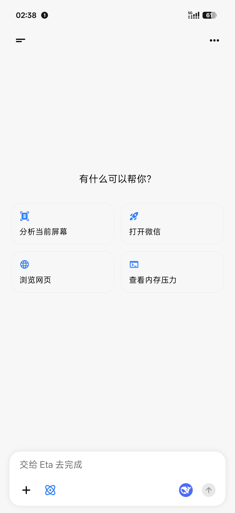
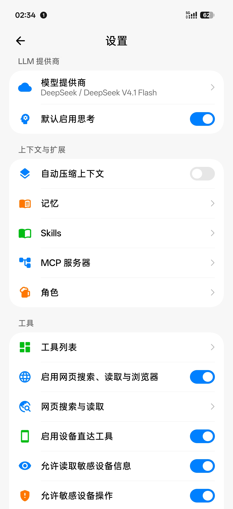
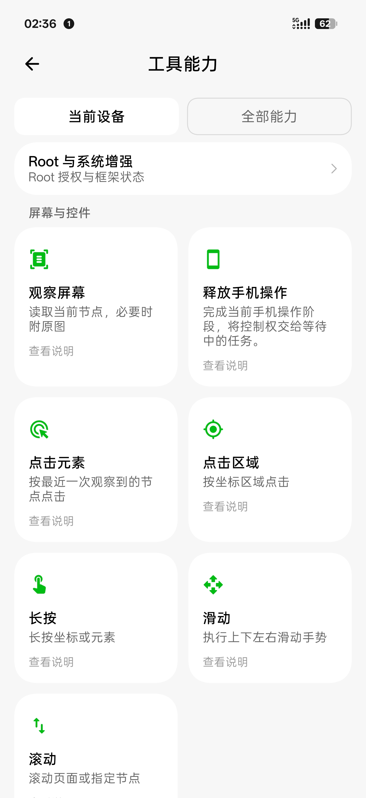

<h1 align="center">Theta · 西塔</h1>

<strong>不止回答，替你行动。</strong>

面向 Android 的行动助手：对话、后台虚拟屏、自动任务与可审批的经验学习。

<strong>简体中文</strong> | <a href="README_EN.md">English</a>

  <a href="https://github.com/ByteJuno/Theta">源码</a> ·
  <a href="https://github.com/ByteJuno/Theta/issues">问题反馈</a> ·
  <a href="#开始使用">开始使用</a> ·
  <a href="#文档">文档</a>

Theta 是 ByteJuno 基于 [Mangi-11/Eta](https://github.com/Mangi-11/Eta) 持续开发的独立衍生项目，**不是 Eta 官方版本**。名称取自 Eta（η）之后的希腊字母 Theta（θ），代表在上游基础上继续探索手机助手的使用体验，不代表官方继任关系。

它既能回答问题，也能通过工具处理文件、读取所需的设备信息、操作应用并执行任务。项目重点是让这些能力更适合日常使用：多个会话独立推进、后台屏幕可查看和接管、任务有执行记录、学到的经验由你决定是否保存。

> **开发状态**：当前已完成 Theta 展示品牌及 `io.github.bytejuno.theta` 包名的源码迁移。该迁移尚未完成编译、完整测试及真机验收，不应视为稳定发行版。项目目前用于个人开发，不提供公开安装包；上游 Eta 的安装包不是 Theta。

## 能做什么

### 后台操作，不必一直占着主屏

- 在具备相应 Root / LSPosed 能力时，通过后台虚拟屏操作应用。
- 胶囊预览可查看执行画面、展开触控接管，必要时将应用交回主屏。
- 每个会话可选择虚拟屏或主屏；物理主屏 GUI 操作有每轮授权边界。
- 多个会话共享屏幕与内置浏览器的交互资源，同一时刻不会各自抢着点击同一界面。

虚拟屏基于 Eta 上游引擎，Theta 保留并整合兼容性修复、显示路线选择与交互资源管理。可用性取决于系统版本、ROM 和授权状态，详见[虚拟屏说明](docs/VIRTUAL_SCREEN.md)。

### 多个会话，各自继续

会话 A 处理任务时，可以切换到 B 开始另一项请求。文字生成、搜索等任务可以并行；屏幕或浏览器操作按共享资源排队。同一会话内支持排队发送、撤回继续编辑和中断插话。

终端文件、Linux 环境及用户配置仍然共享，多会话不等于文件沙箱。详见[多会话执行](docs/MULTI_SESSION.md)。

### 自动任务，有条件也有记录

通过对话创建定时或事件任务，在设置中查看、暂停、手动运行、取消和删除。

- 时间、充电、电量、网络、蓝牙、通知、前台应用及主动分享等触发来源。
- 按需设置匹配条件、冷却时间和执行次数；保存时检查任务依赖环。
- 执行结果有记录，权限不足或模型未配置会报告对应状态。

**Android 后台调度可能延迟，不适合作为准点闹钟。** 后台任务也不是任意工具的无人值守执行入口：主屏 GUI、浏览器 GUI、终端命令和再创建任务受到限制。详见[自动任务](docs/AUTOMATION.md)。

### 经验学习，先提案再生效

任务结束后可以复盘有用的偏好和操作经验，形成记忆或技能方案。方案进入通知中心，**你同意前不会写入现实记忆或安装技能**。

审批包含版本与权限检查；内容已经变化时要求重新完善，结果不确定时不自动重放。自动复盘会产生额外模型请求，可在设置中关闭。当前审批行为以[通知中心与学习审批](docs/LEARNING_INBOX.md)为准，复盘背景见[经验学习](docs/EXPERIENCE_LEARNING.md)。

### 手机上的工具工作区

| 能力 | 说明 |
| --- | --- |
| 文件与终端 | 文件读写、精确编辑、搜索、图片读取、交互式终端、后台命令；可选 Alpine / Debian 环境 |
| 网页与浏览器 | 网页搜索、正文读取、内置浏览器 DOM 操作和截图，可手动接管 |
| 设备工具 | 日历、通知及设备状态查询；Root 与适配 ROM 下扩展系统设置和一方应用操作 |
| Skills / MCP / 子代理 | 按需加载技能、接入远程工具，将子任务交给独立上下文执行 |
| 模型配置 | 自备 API Key，或使用支持的 Codex / Grok 订阅登录；支持单模型测试和输出上限设置 |
| 用量与语音 | 本机按日期、模型记录用量与服务商返回的缓存信息；支持语音输入和助手浮窗连续对话 |

具体能力仍由模型、权限、设备和服务端支持决定。本机用量统计不是服务商账单，不返回缓存数据的服务也不能被当成零缓存命中。

## 设备要求

- **Android 13 及以上、ARM64**。
- 普通设备可使用聊天、网页、文件工作区、普通终端及扩展工具；无障碍、通知、日历等按需授权。
- Root 可进一步开放受保护数据、系统操作、Root Shell 与 chroot 等能力。
- LSPosed 与适配 ROM 可提供厂商助手接管、系统入口和部分后台虚拟屏能力；不是所有品牌、版本均已验证。

详见[设备支持与权限边界](docs/ROOTLESS_SUPPORT.md)及 [HyperOS 系统入口](docs/HYPEROS_SYSTEM_ENTRY.md)。

## 开始使用

### 获取与构建

本仓库目前不提供公开 APK 下载入口。开发构建由维护者在 [GitHub Actions](https://github.com/ByteJuno/Theta/actions) 中，按需从 `main` 手动运行；普通 `main` 推送不自动构建。构建成功也不等于已完成真机验收。

构建工作流目前仍叫 **Eta Build**，APK 文件名仍沿用 `Eta-v…apk`，这是构建兼容命名，不代表包名仍是 Eta。请核对构建提交、应用包名及签名，不要仅凭文件名判断。完整流程见[构建与发布约定](.github/RELEASING.md)。

### 从旧 Eta 转到 Theta

| 项目 | Theta |
| --- | --- |
| GitHub 仓库 | `ByteJuno/Theta` |
| 应用显示名称 | Theta |
| 应用包名 | `io.github.bytejuno.theta` |
| 与旧 Eta 的关系 | 独立安装，可并存，不是覆盖升级 |

旧 Eta 的会话、模型配置、工作区和权限**不会自动迁移**。切换前保留旧应用及必要备份；备份导入兼容性尚需验证，不要先卸载旧应用。Theta 的无障碍、通知、默认数字助理、Root 与 LSPosed 配置需要重新检查和授权。避免同时启用两套针对同一厂商助手的 Hook。

### 首次配置

1. 安装经过验证的 Theta 开发构建，配置模型提供商并选定模型。工具操作需要模型支持 Tool Calling，图片任务还需支持图片输入。
2. 按任务需要开启工具及 Android 权限，在工具页检查当前设备实际可用的能力。
3. 先完成一次简单对话，再逐步验证文件、设备操作、虚拟屏和自动任务，不把所有功能视为已适配。
4. 如果需要系统助手入口或 Linux 环境，再按对应文档完成配置。

## 数据与运行边界

- **本机运行不等于本地推理**：任务所需的对话、图片和工具结果会发送至你配置的模型或工具服务。优先使用 HTTPS。
- **权限按用途配置**：不要把 Root、无障碍或 MCP 的授权当成所有任务都需要的前提。屏幕、终端及远端工具的边界不同。
- **备份可能包含 API Key**：妥善保管，不要上传到公开 Issue；订阅 OAuth 登录令牌不包含在常规备份中。
- **后台不是永不停机**：Android 和厂商省电策略可能延迟或中止任务。中断后的不确定设备操作不应被视为已经成功。
- **学习不是静默自我修改**：现实记忆与技能写入经过通知中心审批，仍需检查方案内容与实际效果。

## 界面参考

以下为仓库继承的 **Eta 历史截图**，仅用于展示交互形态，不是新包名 Theta 的验收截图；名称、图标和部分界面可能与当前代码不同。

| 对话 | 设置 | 工具 |
| --- | --- | --- |
|  |  |  |

## 文档

- [多会话执行](docs/MULTI_SESSION.md)
- [虚拟屏与接管](docs/VIRTUAL_SCREEN.md)
- [自动任务](docs/AUTOMATION.md)
- [通知中心与学习审批](docs/LEARNING_INBOX.md)
- [经验复盘背景](docs/EXPERIENCE_LEARNING.md)
- [语音功能](docs/VOICE.md)
- [角色会话](docs/CHARACTERS.md)
- [设备支持](docs/ROOTLESS_SUPPORT.md)
- [Agent Runtime 与文件工具合同](docs/AGENT_RUNTIME.md)
- [技术实现](docs/TECHNICAL.md)
- [终端原生组件](docs/TERMINAL_NATIVE.md)
- [构建与发布](.github/RELEASING.md)

部分技术文档仍保留 Eta 的历史名称，内部类名、协议和产物命名也可能继续沿用；这不代表新包名迁移已经通过完整验证。

## 反馈与开发

Theta 的问题请提交至 [ByteJuno/Theta Issues](https://github.com/ByteJuno/Theta/issues)，不要把 fork 独有的问题直接发到上游。请注明版本或提交号、Android / ROM、Root / LSPosed 状态、复现步骤与脱敏日志。

开发约定见 [AGENTS.md](AGENTS.md)：改动应有对应回归测试，编译、单元测试、Lint 和 APK 打包按仓库约定在 GitHub Actions 执行。未构建、未测试或未真机验证的内容必须明确标注。

## 来源与许可证

Theta 基于 [Mangi-11/Eta](https://github.com/Mangi-11/Eta)，保留上游贡献与许可证，不声称原项目为独立原创。更名和修改包名不改变许可义务。

项目采用 [PolyForm Noncommercial License 1.0.0](LICENSE)。使用、修改与分发请遵守许可证及随附声明；商业用途需另行取得适用授权。第三方组件信息见 [THIRD_PARTY_NOTICES.md](docs/THIRD_PARTY_NOTICES.md)。

感谢 Eta 上游及其依赖与参考项目，包括 [Pi Coding Agent](https://github.com/earendil-works/pi)、[OmniBot](https://github.com/omnimind-ai/OmniBot)、[libxposed](https://github.com/libxposed/api) 和 [Miuix](https://github.com/compose-miuix-ui/miuix)。
