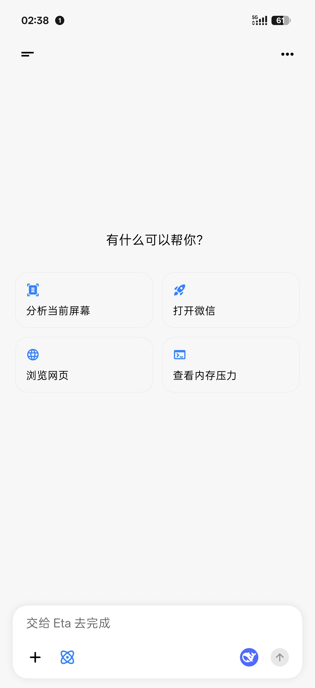
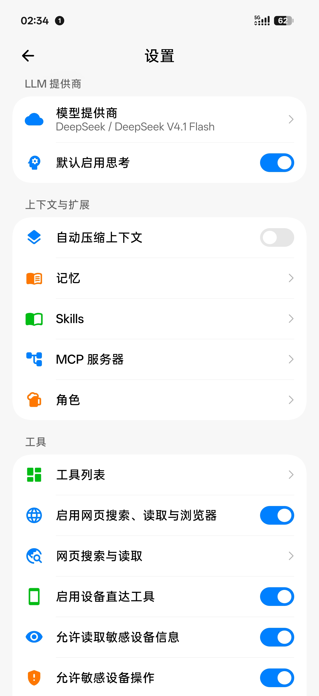
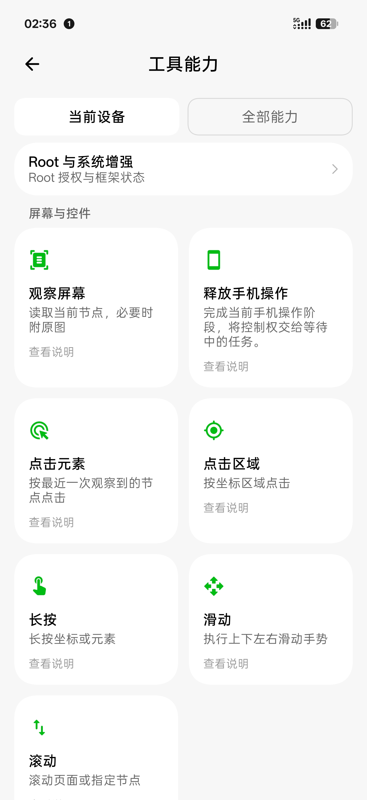

<h1 align="center">Theta</h1>

<strong>Beyond answers. Into action.</strong>

An Android action assistant with conversations, a background virtual display, automation, and reviewed experience learning.

<a href="README.md">简体中文</a> | <strong>English</strong>

  <a href="https://github.com/ByteJuno/Theta">Source</a> ·
  <a href="https://github.com/ByteJuno/Theta/issues">Issues</a> ·
  <a href="#getting-started">Getting started</a> ·
  <a href="#documentation">Documentation</a>

Theta is an independent derivative of [Mangi-11/Eta](https://github.com/Mangi-11/Eta), developed by ByteJuno. **It is not an official Eta release.** Theta (θ) follows Eta (η) in the Greek alphabet: a reference to building on upstream work, not a claim of official succession. Its Chinese name is 西塔.

Beyond answering questions, Theta can use tools to work with files, access relevant device information, operate apps, and execute tasks. The focus is everyday usability: independent conversations, visible and interruptible background interaction, execution records, and your control over which learned experiences are saved.

> **Development status:** The source has been migrated to the Theta display brand and the `io.github.bytejuno.theta` application ID. This migration has not yet completed compilation, full testing, or device acceptance testing. It is not a verified stable release. This is a personal development project with no public APK distribution; upstream Eta APKs are not Theta builds.

## Capabilities

### Background interaction without constantly occupying your screen

- Operate apps on a background virtual display when the required Root / LSPosed capabilities are available.
- Inspect progress through the capsule preview, expand it for touch takeover, or move the app back to the physical display.
- Choose the virtual or physical display per conversation, with per-run approval boundaries for physical-screen GUI actions.
- Share screen and built-in browser interaction resources across conversations instead of letting concurrent tasks click the same interface independently.

The virtual display uses the upstream Eta engine, with compatibility fixes, display routing, and interaction resource management integrated in Theta. Availability depends on Android, the ROM, and permissions. See [virtual display documentation](docs/VIRTUAL_SCREEN.md).

### Independent conversations

Start a request in conversation B while A is still running. Text generation and search can run concurrently; screen and browser interactions wait for shared resources. Each conversation supports queued messages, recall for editing, and interruption.

Files, Linux environments, and user configuration remain shared: concurrent conversations are not file sandboxes. See [multi-session execution](docs/MULTI_SESSION.md).

### Automation with conditions and execution records

Create scheduled or event-driven tasks in chat. Inspect, pause, run, cancel, and delete them in settings.

- Time, charging, battery level, network, Bluetooth, notifications, foreground apps, and explicit content shares can provide triggers.
- Configure matching conditions, cooldowns, and run limits; task dependency cycles are checked when saving.
- Execution records distinguish results, missing permissions, and missing model configuration.

**Android background scheduling may be delayed; it is not a punctual alarm service.** Background tasks are also not unrestricted unattended tool execution: physical-screen GUI, browser GUI, terminal commands, and creating further tasks are restricted. See [automation](docs/AUTOMATION.md).

### Learning through proposals, not silent changes

After a task, an optional review can identify useful preferences or procedures and propose memory or skill changes. Proposals appear in the notification center. **They do not modify real-world memory or install skills until you approve them.**

Approval checks permissions and revisions. Stale proposals require revision, and uncertain outcomes are not replayed automatically. Reviews make additional model requests and can be disabled in settings. See [learning approvals](docs/LEARNING_INBOX.md) for current write behavior and [experience learning](docs/EXPERIENCE_LEARNING.md) for background.

### A mobile tool workspace

| Capability | Details |
| --- | --- |
| Files and terminal | Read, write, exact edits, search, image inspection, interactive terminals, and background commands; optional Alpine / Debian environments |
| Web and browser | Search, page text, built-in browser DOM interaction and screenshots, with manual takeover |
| Device tools | Calendar, notifications, and device state; Root and supported ROMs extend system settings and first-party app operations |
| Skills, MCP, and subagents | Load skills on demand, connect remote tools, and delegate subtasks to independent contexts |
| Models | Bring your own API key or use supported Codex / Grok subscription sign-in; per-model testing and output limits |
| Usage and voice | Local usage records by date and model, provider-reported cache information, speech input, and continued conversation in the assistant overlay |

Capabilities depend on the model, permissions, device, and service. Local usage records are not provider invoices; missing cache data must not be interpreted as a zero cache hit rate.

## Device requirements

- **Android 13 or later, ARM64**.
- Standard devices can use chat, web tools, the file workspace, user-level terminals, and extensions. Accessibility, notifications, calendar, and other permissions are granted as needed.
- Root enables additional protected data access, system operations, Root Shell, and chroot capabilities.
- LSPosed and supported ROMs enable vendor-assistant integration, system entry points, and some background virtual-display capabilities. Not every device or version has been verified.

See [device support and permissions](docs/ROOTLESS_SUPPORT.md) and [HyperOS integration](docs/HYPEROS_SYSTEM_ENTRY.md).

## Getting started

### Builds and availability

This repository currently provides no public APK download entry. Maintainers can manually build `main` through [GitHub Actions](https://github.com/ByteJuno/Theta/actions). Ordinary pushes to `main` do not automatically build. A successful build is not device acceptance testing.

The workflow is still named **Eta Build**, and APK filenames still follow `Eta-v…apk`. These are retained build conventions, not the application ID. Check the source commit, application ID, and signing certificate rather than relying on filenames. See [building and releases](.github/RELEASING.md).

### Moving from Eta to Theta

| Item | Theta |
| --- | --- |
| Repository | `ByteJuno/Theta` |
| App display name | Theta |
| Application ID | `io.github.bytejuno.theta` |
| Relationship to Eta | Separate installation; can coexist, not an in-place upgrade |

Eta conversations, model settings, workspaces, and permissions **do not migrate automatically**. Keep the old app and necessary backups before switching. Backup import compatibility still needs verification; do not uninstall Eta first. Recheck and grant Theta accessibility, notification, default assistant, Root, and LSPosed access as appropriate. Avoid enabling both apps' hooks for the same vendor assistant simultaneously.

### Initial configuration

1. Install a verified Theta development build, configure a provider, and select a model. Device tasks require tool calling; image tasks also require image input support.
2. Enable the tools and Android permissions needed for your task. Check actual device capabilities on the tools page.
3. Start with a simple conversation, then verify file access, device actions, the virtual display, and automation incrementally. Do not assume every integration is supported.
4. Configure system assistant entry points or a Linux environment separately if needed.

## Data and execution boundaries

- **Local runtime is not local inference:** relevant conversations, images, and tool results go to your configured model or tool service. Prefer HTTPS.
- **Permissions serve specific capabilities:** Root, accessibility, or MCP access is not required for every task. Screen, terminal, and remote-tool boundaries differ.
- **Backups may contain API keys:** keep them private and do not attach them to public issues. Subscription OAuth tokens are excluded from regular backups.
- **Background execution is not guaranteed uptime:** Android and vendor power management may delay or interrupt tasks. Uncertain device actions after interruption are not confirmed successes.
- **Learning is not silent self-modification:** real-world memory and skill writes go through approval. Review both the proposal and its actual effect.

## Interface reference

These are **historical upstream Eta screenshots** inherited by the repository. They illustrate interaction patterns, not acceptance tests of the renamed Theta package. Names, icons, and some screens may differ from current code.

| Chat | Settings | Tools |
| --- | --- | --- |
|  |  |  |

## Documentation

Most detailed documentation is currently in Chinese.

- [Multi-session execution](docs/MULTI_SESSION.md)
- [Virtual display and takeover](docs/VIRTUAL_SCREEN.md)
- [Automation](docs/AUTOMATION.md)
- [Notification center and learning approvals](docs/LEARNING_INBOX.md)
- [Experience review background](docs/EXPERIENCE_LEARNING.md)
- [Voice](docs/VOICE.md)
- [Character conversations](docs/CHARACTERS.md)
- [Device support](docs/ROOTLESS_SUPPORT.md)
- [Agent Runtime and file tool contracts](docs/AGENT_RUNTIME.md)
- [Technical implementation](docs/TECHNICAL.md)
- [Native terminal components](docs/TERMINAL_NATIVE.md)
- [Building and releases](.github/RELEASING.md)

Some technical documentation retains the historical Eta name, as do internal classes, protocols, and build artifacts. These names are not evidence that the new application ID has passed full validation.

## Feedback and development

Report Theta issues to [ByteJuno/Theta Issues](https://github.com/ByteJuno/Theta/issues), rather than sending fork-specific problems directly upstream. Include the version or commit, Android / ROM, Root / LSPosed setup, reproduction steps, and redacted logs.

See [AGENTS.md](AGENTS.md) for development conventions. Changes should include regression tests. Compilation, unit tests, Lint, and APK packaging follow the repository's GitHub Actions workflow. Clearly identify anything not built, tested, or verified on a device.

## Attribution and license

Theta derives from [Mangi-11/Eta](https://github.com/Mangi-11/Eta), preserves upstream attribution and licensing, and does not claim the original project as independent work. Renaming the app or application ID does not change licensing obligations.

The project uses the [PolyForm Noncommercial License 1.0.0](LICENSE). Use, modification, and distribution must comply with the license and accompanying notices; commercial use requires appropriate separate authorization. See [third-party notices](docs/THIRD_PARTY_NOTICES.md).

Thanks to Eta upstream and its dependencies and references, including [Pi Coding Agent](https://github.com/earendil-works/pi), [OmniBot](https://github.com/omnimind-ai/OmniBot), [libxposed](https://github.com/libxposed/api), and [Miuix](https://github.com/compose-miuix-ui/miuix).
